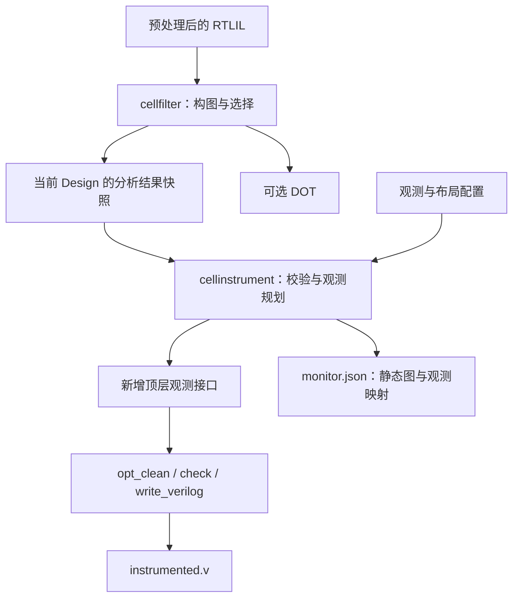

# CellFuzz：Yosys 侧观测插装设计

状态：2026-11-05 按已确认设计分阶段实施。当前 `cellfilter` 已实现 node 类型配置、region 选择策略、共享选择/view 及会话内分析结果交接；`cellinstrument` 已实现 2A 类型规划、2B 确定性静态契约、3A 普通旁路物化、3B Ibex 实际值闭环及 register 补充验收，以及第四步 Memory 业务端口观测和第五步可选内容查询。Yosys 侧首版观测能力已实现。

阶段进展：共享服务见 [Stage1ASharedGraph.md](Stage1ASharedGraph.md)；会话快照、发布和恢复绑定见 [Stage1BCSessionSnapshots.md](Stage1BCSessionSnapshots.md)；类型规划见 [Stage2ATypePlanning.md](Stage2ATypePlanning.md)；静态 schema 见 [Stage2BManifest.md](Stage2BManifest.md)；物化与失败边界见 [Stage3AMaterialization.md](Stage3AMaterialization.md)；实际值回归及夹具来源见 [Stage3BValueRoundtrip.md](Stage3BValueRoundtrip.md)。默认命令输出 `status: materialized`、`stage: observation-materialization`；`-plan-only` 输出 `status: planned`、`stage: observation-planning`。

Memory 默认业务观测 on、内容查询 off；业务口静态字段、原端口切片及专项验收见 [Stage4MemoryAccess.md](Stage4MemoryAccess.md)；独立单字查询接口、地址编码、业务保持与失败验收见 [Stage5MemoryQuery.md](Stage5MemoryQuery.md)。

## 1. 目标和本次边界

项目希望利用选中 cell 的运行时观测，判断硬件是否探索到新状态，为外部大模型 generator 的测试生成与变异提供反馈。初步的判新方向是观测值的联合组合首次出现；具体算法由后续工作确定。

本次交付限于 Yosys，提供：

1. 同一会话内，`cellfilter` 向独立的 `cellinstrument` 传递分析结果。
2. 依据明确规则，将选中对象的观测信号连接到新增顶层接口。
3. 输出插装前的完整 CellGraph 描述、观测项及可逆的位段映射。
4. 导出保持原功能语义的 Verilog。

Verilator 侧采集器、adapter 生成器、运行时事件协议、memory 扫描/快照、状态判新和 generator 均为后续交付。实际 Verilator 模型与静态描述之间的身份校验也后置。当前仍需校验两个 Yosys pass 之间分析结果是否过期，这属于插装正确性的必要检查。

## 2. 两个独立 pass 的工作流



- `cellfilter` 独占 node 类型、region 策略及其参数；继续支持单独检查图。
- `cellinstrument` 消费已保存的选择结果，配置 memory 观测能力和接口布局。
- 共享实现提供图模型、结果保存/读取、源信号绑定及序列化服务。

`cellinstrument` 必须使用先前成功发布的分析结果。它不接收 `-nodes`、`-topk`、`-edge-topk` 或 `-objects` 等选择参数。普通 edge 输出、mux 选择信号和 register Q 是固定的首版规则，不提供关闭这些必选项的开关。

正式流程如下；两个 pass 在同一个 Yosys 进程中执行：

```text
read_verilog /root/workflow/ibex.v
hierarchy -top ibex_core
proc; memory_collect; flatten

cellfilter -nodes all -topk 2 -dot interested.dot
cellinstrument -manifest monitor.json -chunk-width 128
write_rtlil instrumented.il
opt_clean
check -assert
write_verilog instrumented.v
```

选择算法复用现有实现，评分与折叠细节见 [RegionTopKDesign.md](RegionTopKDesign.md)。本次不重新实现 top-k。

这是正式导出顺序：映射必须放在插装之后。`write_rtlil` 是可选诊断/重试检查点；不得在 `cellfilter` 和 `cellinstrument` 之间改写结构。组合类型按已验证的 backend/model 路径显式列入允许表，未知类型在全模块预检拒绝。映射后内部 cell 的替换不改变 manifest 冻结的源身份；下游通过新增顶层接口、方向、宽度和位段消费观测值。

`materialized` 只表示 RTLIL 插装及 manifest 发布成功。映射、导出、回读或 lint 失败时，该目录不能交付；在新输出目录完成全部检查后再向下游提供，不增加跨文件原子发布协议。最终 Verilog 必须在新进程回读并 lint，例如 `$fa` 的可复制输入见 `tests/cellfuzz/fixtures/fa.il`：

```sh
mkdir -p /tmp/cellfuzz-fa-export
build/yosys -p 'read_rtlil tests/cellfuzz/fixtures/fa.il; cellfilter; cellinstrument -manifest /tmp/cellfuzz-fa-export/monitor.json; write_rtlil /tmp/cellfuzz-fa-export/instrumented.il; opt_clean; check -assert; write_verilog /tmp/cellfuzz-fa-export/instrumented.v'
build/yosys -p 'read_verilog /tmp/cellfuzz-fa-export/instrumented.v; hierarchy -check -top top; proc; check -assert'
verilator --lint-only --top-module top -Wno-fatal /tmp/cellfuzz-fa-export/instrumented.v
```

验收还要从最终网表检查原业务端口和 manifest 的全部新增接口及数值，而非只检查映射前 RTLIL。`tests/cellfuzz/export_matrix.py` 记录逐类型参数样例和二态数学 oracle；除零未定义域、X/Z、三态关闭/多驱动不由二态值检查证明。simcells 的已有 tristate 警告须分类审阅。

插装 pass 的拟议参数限于以下内容：

| 参数 | 首版约定 |
| --- | --- |
| `-manifest <file>` | 必填；输出静态图与观测映射 |
| `-plan-only` | 完成预检和布局，输出 planned 描述 |
| `-mem-access on\|off` | 默认 on |
| `-mem-content off\|query` | 默认 off |
| `-chunk-width <bits>` | 正整数，建议默认 256 |
| `-prefix <name>` | 合法受控标识符，建议默认 cf |

未知参数或无效值明确报错；预留的输入观测接口不对应首版可用参数。

## 3. 会话内分析结果交接

### 3.1 选择与 view 的边界

现有接口保持以下职责：

```cpp
CellGraph graph(module, build_options);
graph.build();
CellGraphSelection selection = graph.select_objects(filter_options);
CellGraphView view = graph.create_view(selection);
```

`select_objects()` 确定集合；`create_view()` 仅据此生成展示连接。region 回调可以返回空集或任意大小的子集，存在时优先于内置 top-k。未显示的 NODE 阻断折叠；隐藏 EDGE 可以被折叠。view 不重新选择对象。

`-nodes` 默认 register、memory、fsm 全选；支持 mem 别名和 all/none。未选状态类型设为 EXCLUDED，保留在 GraphCell 登记和 RTLIL 中，但不作为遍历种子，也不能被穿过。内部显式将状态类型设为 EDGE 的入口保留，首版 CLI 不开放该语义。

### 3.2 AnalysisSnapshot

`cellfilter` 无论是否输出 DOT，都执行选择并保存分析快照。建议首版只维护最近一次调用发布的结果批次，一批可以包含多个模块的分析记录。

快照至少保存：

- 版本、模块标识、构图有效配置和策略标识/版本/参数。
- 当前模块的结构摘要，以及快照标识 `analysis_id`。
- 明确选中对象的名称/身份、module port 集合、region 与选择说明。
- 恢复图结构和源绑定所需的无指针记录。

会话存储跟随当前 `Design`，通过共享的 SnapshotStore 封装。当前使用 `Design::scratchpad["cellfuzz.analysis"]` 保存带版本的内部 JSON 记录，以原始名称和有序 bit 引用无歧义地编码 RTLIL 身份。快照不保存 `Cell*`、`Wire*`、`SigMap` 等跨命令裸指针。编码及恢复入口见 [阶段 1B/1C](Stage1BCSessionSnapshots.md)，不形成外部文件接口。

插装时按标识重新绑定当前对象；如需恢复邻接结构，可复用共享构图器并采用保存的对象集合，不能重跑评分或改变选中对象。允许保存图的完整值记录，也允许保存可精确恢复原分析结果的记录；两者都必须通过同一快照往返验收。

首版仅支持同一会话中的结果交接，不实现分析结果文件导入。`design -save/-load/-push/-pop` 等操作不承担分析结果持久化契约。

### 3.3 发布与有效性

1. 新一次 `cellfilter` 调用开始时，使上一批结果失效；本次所有目标模块成功后一次发布。失败后没有可消费的旧结果。
2. `cellinstrument` 从快照中查找当前 top 的结果，校验结构摘要、对象类型、参数、端口与绑定。缺失或不匹配时要求重新运行 `cellfilter`。
3. 结构摘要覆盖模块端口/wire、cell 类型/参数/连接、模块连接、初始化和相关依赖定义。无序记录排序，SigSpec 中的位序、重复 bit 和常量保持原样。
4. 摘要排除时间戳、输出路径、scratchpad 和临时选择栈。单纯读取、查看统计不会造成过期；改变设计内容需要重新分析。
5. `-plan-only` 不修改设计或消耗有效结果。正式插装一旦开始物化，原结果失效；成功后模块带插装标记，重复插装明确报错。

分析快照和结构摘要服务于两次 pass 的交接，不承诺跨源码或跨 Yosys 版本的对象身份稳定性。

## 4. 首版观测规则

只有保存的 selection 中的对象可以生成观测项。完整图中其他对象仍保留结构和未观测原因。`in_graph`、`selected` 和 `observed` 分别表达构图结果、对象选择和实际观测，不能混用。

| 对象 | 首版实际观测 | 扩展接口 |
| --- | --- | --- |
| 普通组合 edge cell | 所有已知输出端口 | 输入端口 |
| mux 家族 | 所有输出及完整选择信号 | 其他数据输入 |
| register，包括受支持的 latch | Q | D、异步加载数据、enable/reset 等控制 |
| memory | 业务端口默认开启；内容查询默认关闭 | 两项独立配置 |
| 原有顶层 module port | 保留图中身份、方向、位宽和连接，复用原功能接口 | 后续消费方式 |

新增的观测顶层端口与原功能端口分别登记。原顶层输入/输出无需为同一边界值重复生成旁路项；内部 cell 的观测信号通过新增端口导出，即使它与某个原功能输出恰好别名，也保留独立观测身份。

### 4.1 组合 cell 和 mux

不能假定组合 cell 只有一个 Y。例如 `$alu` 输出 X/Y/CO，`$fa` 输出 X/Y，`$lcu` 输出 CO；所有输出均应观测。以 Yosys 正式类型定义提供的方向为准，不按端口名猜测输出。

mux 类型采用明确分派：

| 类型 | 额外观测的选择端口 |
| --- | --- |
| `$mux`、`$pmux`、`$bmux`、`$demux`、`$bwmux` | S |
| `$_MUX_`、`$_NMUX_` | S |
| `$_MUX4_` / `$_MUX8_` / `$_MUX16_` | S,T / S,T,U / S,T,U,V |

选择向量按原位宽和位序导出，不解码为分支号，也不假定 `$pmux.S` 一定 one-hot。其他输入只保留内部扩展位置，首版不暴露尚未实现的配置参数。

当前 CellGraph 的 EDGE 是分析角色；未知/自定义 cell 不能仅凭该角色被断言为无状态组合逻辑。首版插装必须验证类型和端口方向，无法确认语义或导出支持时在预检阶段诊断。

### 4.2 Register

使用 `FfData` 解析寄存器类型、Q 与时钟/控制语义，避免复制 FF 类型表。Q 是必选观测源；时钟绑定、极性、latch 属性及控制语义作为静态描述保留。首版不为 D 或普通控制输入生成观测项。

若输出静态初始化说明，应结合 `FfInitVals` 解析 wire 上的初值；`FfData(nullptr, cell)` 本身不填充 Q 的 `val_init`。静态未知位描述不代表未来 Verilator 运行值具有严格四态语义。

内部时钟、异步控制和 latch 的源信号可以可见，但逐事件采集能力留待后续设计。具有隐式全局时钟、当前 Verilog 后端无法行为展开的 FF，以及显式 `$fsm`，首版在导出支持性预检中报错；普通 FSM 状态寄存器仍按 register 处理。

## 5. Memory 的两项独立能力

两个开关只影响已选 memory 的观测，不改变 cellfilter 的选择结果。

| 业务观测 | 内容查询 | 接口 |
| --- | --- | --- |
| on | off | 默认；导出业务端口信号 |
| off | off | 保留图和 memory 描述，说明本次没有 memory 专用观测 |
| off | query | 仅提供实际内容的地址查询接口 |
| on | query | 同时提供两项能力 |

### 5.1 业务端口观测

通过 `Mem::get_all_memories()` 读取 collected memory，按原业务读/写端口编号登记：

- 写口的地址、数据、逐 bit enable/mask，以及存在的 clock 信号。
- 读口的地址、数据、enable、clock、异步/同步 reset 等实际信号。
- 位宽、宽端口分词、时钟有效性/极性、写优先级、读透明性/碰撞、初始化/reset 值和控制优先级等静态语义。

所有业务信号复用普通观测输出的打包机制，静态属性放入描述文件；固定无效的辅助信号可由常量绑定说明。原业务端口身份在新增调试读口前冻结。

输出表示当前信号值。一次读写是否已经提交、应当何时采样，由未来采集层判断。同步读口的保持值是额外时序状态，单独读取数组不能代替它；关闭业务观测时应明确记录这一覆盖减少。

第四步已实现上述业务观测，逐逻辑端口字段生成 `memory_access` item；原 collected GraphPort 的切片由 item.port_lsb 与 width 指定。无效 clock、恒无效 reset、legacy 缺失的 reset 和零宽地址只记录静态源及原因，不创建零宽或无效控制项。宽端口保留 helper 逻辑编号、原 packed 起点及分词数，掩码按逻辑写口编号解释；完整 packed 参数仍保存在原图。仅业务观测时原 memory cell 不重写，负 offset 可用；启用查询时按 §5.2 校验地址并增加读口。

### 5.2 内容查询

每个启用 query 的 memory 增加一个单字异步只读口，通过 `Mem::rd_ports` 与 `Mem::emit()` 连接实际数组：

```text
cf_mem_0003_addr  input   查询逻辑地址
cf_mem_0003_data  output  对应地址的当前单字内容
```

查询接口独立于普通观测输出块。每个 memory 独立寻址，首版采用无时钟、恒使能的查询读口。数据在组合求值稳定后有效。接口负责读出内容，遍历地址和组织快照属于后续采集层。

实现必须完整初始化 `MemRd` 的位宽、init/reset 值以及与原写口数匹配的 transparency/collision 掩码，并调用 `Mem::check()`。保留原读写端口、初始化、优先级和读响应语义。

静态说明记录 `[start_offset, start_offset + size)`、单字宽度、地址位宽和编码。地址以 memory 的逻辑地址表达；首版支持经过验证的非负 offset，负 offset 或无法证明安全的地址扩展在启用 query 时预检报错。越界地址不承诺有效查询结果。

`Mem::emit()` 可能统一地址宽度，规划和物化都必须检查原业务地址含义不变。memory 修改先在 helper 中全部校验后再 emit；修改后不再用原 GraphPort 布局解释新 memory。

第五步已实现：`content_query` 表示是否对该原 memory 启用查询，`query` 为 null 或独立接口描述。memory 序号按全部原 memory 的 cell 名排序，名称为 `<prefix>_mem_NNNN_addr/data`；接口在原接口和普通输出块之后成对附加。地址宽度为覆盖最后逻辑地址的最小正位宽（单字零地址也为 1），支持非负且最后地址不超过 INT_MAX 的范围，地址编码为 `unsigned_logical`。Mem::emit 保留较宽的原业务地址，仅在需要时高位补零；query 描述保存 logical/packed 新读口编号，业务编号及 source 仍引用冻结原图。规划在任何产物准备前检查完整查询 helper 和地址归一化后的 RTLIL 宽度，物化先准备所有 helper 再统一 emit，随后核对业务控制、掩码、初始化、几何和查询绑定。legacy `$mem` 可规范化为 `$mem_v2`。

## 6. 普通观测值的可逆打包

普通观测源直接连接到新增顶层 output，不增加采样寄存器或历史状态。输出采用有界宽度的块，建议默认上限 256 bit，并允许配置。最后一块采用实际宽度；空计划不创建零宽端口。

每个逻辑观测项保存 `monitor_id`、图对象/端口、role、源绑定和逻辑位宽。每个位段保存：

```text
monitor_id, item_lsb, port_name, port_lsb, width
```

例如某个 `$pmux` 的 Y 为 32 bit、S 为 4 bit：

| 观测来源 | 新增顶层接口 |
| --- | --- |
| cell_42.Y[31:0] | cf_obs_0000[31:0] |
| cell_42.S[3:0] | cf_obs_0000[35:32] |

可逆性要求：

1. 源 `SigSpec[i]` 对应逻辑观测值 bit i；原始 wire 位偏移、常量、拼接、切片和重复 bit 均保留。
2. 每个 item 的位段恰好覆盖 `[0, width)`，无缺口或重复覆盖，目标位段合法且首版互不重叠。
3. 支持跨块、超过 64 bit 的值和非整 word 尾部；解包依据位段，不依赖 JSON 顺序或宿主字节序。
4. 首版为每个 item 独立布局，即使多个 item 来自相同信号，也保留各自身份和位段。
5. 原始值完整输出。哈希、覆盖 bitmap 和有损压缩属于未来反馈消费者。

新增名称采用受控 ASCII 标识符，检查已有名称、生成名称、语言保留字及 Verilator 保留前缀冲突。物化后调用 `fixup_ports()`，核对实际端口与计划并检查 RTLIL。

## 7. 完整静态图与观测映射

首版使用一个 `monitor.json` 同时保存静态图和观测映射，避免图与位段表各自成为不一致的数据源。

“完整图”指插装前的 CellGraph 分析快照：包含所有登记 cell 和 port，记录语义类型、图角色、`in_graph`、选中/观测状态及原图保留连接。未进入保留图的对象保留原因。它不增加 CellGraph 原本未保留的物理连接；若以后需要完整 RTLIL 物理网络，应另行扩展构图范围。

原有连接完整导出；top-k view 中的折叠连接放在独立的 `view` 中，不能替代原图。`bit_count` 仅是统计，折叠边也不是逐 bit 功能依赖。端口源绑定保留有序 bit 引用，供精确观测和别名解释使用。

下列静态契约沿用 2B/3A 的字段编码和 ID 命名空间，见 [Stage2BManifest.md](Stage2BManifest.md)。第四步增加原端口切片和 memory 业务语义，第五步增加 memories[].query 映射；正式物化保持冻结的原 graph/selection/view/items，普通输出在 transport 登记，独立查询接口仅在所属原 memory 的 query 中登记：

| 字段 | 内容 |
| --- | --- |
| `schema_version` / `status` | 版本；planned 或 materialized |
| `producer` / `analysis` | 工具版本、analysis_id、模块结构摘要、选择有效配置 |
| `config` | memory 开关、块宽、前缀等实际生效观测配置 |
| `graph` | cell、原 module port、cell port、引用的 wire、原图连接、来源和状态 |
| `selection` / `view` | 明确对象集合、region 说明及展示连接 |
| `items` | monitor ID、owner、源端口及 port_lsb、role、位宽、源绑定；memory_access 可覆盖原端口切片 |
| `memories` | 原 cell/port、参数、逻辑读写口、源切片及 monitor 引用、初始化/控制/优先级/碰撞语义、关闭原因与保持状态覆盖；查询接口后续扩充 |
| `transport` | 新增顶层端口及 item 位段 |
| `diagnostics` / `summary` | 未观测原因、支持限制、数量与总位宽 |

图内 ID 和 monitor ID 属于本次分析/导出；同时保存无歧义的模块/对象原名、类型、参数和可用来源属性。来源缺失时属性键不存在。2B 按原名排序分配连续导出 ID，并保留 `analysis_cell_id` / `analysis_port_id` / `analysis_connection_id` / `analysis_region_id` 对应原快照；所有导出引用使用同一套导出 ID，不重排或修改 live RTLIL。

位向量参数和常量使用位宽加字符串表示，保留 X/Z；wire 记录宽度、声明索引信息，bit 绑定使用 RTLIL 逻辑偏移。新增观测端口放入 transport，不混入插装前功能图。

“可还原”包含两项独立保证：从静态记录还原导出的 CellGraph 结构；从映射和接口值还原全部已观测 item。未观测对象没有运行值；memory 数组按查询地址读取。运行时事件、采样阶段和联合状态判新不在本次 schema 中冻结。

## 8. 插装预检、失败边界与产物

首版以一个已展开 top 为目标，要求 whole-module selection、无 process、memory 已 collected、无残留普通模块层次。实际检查 `flatten` 的结果；方向未知或缺少导出支持的对象在规划阶段诊断。

正式执行顺序为：

```text
检查 top 与分析快照
  → 校验结构摘要并恢复对象绑定
  → 冻结原图与来源、生成 MonitorPlan
  → 类型支持/命名/位宽/memory 约束检查和布局
  → 检查原 RTLIL，完整写入并关闭临时 manifest
  → 物化普通旁路与可选 memory 查询
  → 检查实际新增接口和源绑定
  → 发布 materialized manifest，写入成功插装标记
```

MonitorPlan 只描述源、role、静态类型语义、查询能力和布局，不包含首版尚未决定的运行时事件模型。`-plan-only` 完成相同预检并发布 planned manifest，保持 RTLIL 和模块端口不变。

manifest 先写入同目录临时文件，确认写入、flush、close 成功后再物化，最终检查成功后原子替换。原 module 的完整 RTLIL 检查放在临时文件创建之前，因为其致命断言不能通过命令异常清理；新增接口与逐段绑定则在物化后独立校验。物化前可发现的错误必须提前报告；物化开始后不承诺整个 Design 自动回滚，失败时清理临时文件并要求重新加载 prepared 设计、重跑 cellfilter。物化或最终检查失败不发布新正式 manifest，也不设置成功标记；最终文件发布失败时命令失败，当前 Design 同样应丢弃。成功标记在发布成功后设置，避免发布失败留下成功状态。

`check -assert` 用于 RTLIL 检查；导出支持性还需实际 `write_verilog` 验证。Verilator lint/编译可作为接口可用性的辅助验证，不意味着交付 Verilator 侧采集系统。

## 9. 验证对象和后续工作

3B 的真实回归使用仓库内 `tests/cellfuzz/fixtures/ibex` 中固定哈希的 `ibex_branch_predict` 和 `ibex_controller`，来源及可复现提取方式见该目录 README。按约定预处理后，分支预测器有 20 个组合 cell：1 个 `$add`、5 个 `$and`、8 个 `$eq`、5 个 `$or`、1 个 `$pmux`；没有 FF 或 memory。controller 补充 10 路真实 register Q 和控制路径。两者验证导出 Verilog 回读后的实际输出与 S/Q、图与映射、可逆打包和原功能保持。

寄存器和 memory 用小型专用 RTL 用例补充，分别覆盖 Q/初值/时钟语义，以及业务端口、掩码、多端口、同步读保持、内容查询和非零 offset。测试夹具应可独立获取，仓库回归不以 `/root/workflow` 绝对路径作为必要依赖。

后续依次讨论/交付：Verilator 采集与事件关系、memory 快照、联合状态判新和图引导 generator、实际模型与 manifest 的身份绑定。D/其他组合输入观测、FSM 语义、内部事件捕获及其他选择策略保留为扩展。

实施拆分及验收见 [InstrumentImplementationPlan.md](InstrumentImplementationPlan.md)。
